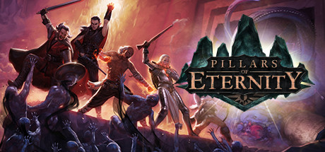

**Pillars of Eternity is a spiritual successor to Baldur's Gate delivering a rich low-fantasy world, a party-based CRPG with a deep soul-based cosmology, and hundreds of hours of reactively written quests. One of the most acclaimed CRPGs of the modern era.**

---

## 📖 About

Pillars of Eternity is a spiritual successor to Baldur's Gate delivering a rich low-fantasy world, a party-based CRPG with a deep soul-based cosmology, and hundreds of hours of reactively written quests. One of the most acclaimed CRPGs of the modern era.

## ⚠️ Problems Without Trainer

| Problem | Status |
|---------|--------|
| **System Depth** — Combat mechanics require understanding Engagement, Endurance vs Health, and per-rest abilities | ✅ Solved |
| **Early Difficulty** — White March and expert settings are brutally punishing for newcomers | ✅ Solved |
| **Sidequests Volume** — Main story buried under an enormous optional quest load | ✅ Solved |
| **Build Pitfalls** — Wrong attribute distribution locks characters out of effectiveness | ✅ Solved |

## ✅ Solution

The **Pillars of Eternity Trainer** solves all these issues by giving you complete control over the game.

## 🎯 Full Feature List

- Unlimited Resources
- God Mode / Invincibility
- Instant Skill Cooldown
- One-Hit Kill
- Freeze Game Timer
- Unlock All Items & Achievements
- Custom Speed Multiplier
- Save State Anywhere

## 🚀 Quick Start

1. **Disable Windows Defender** temporarily (trainer may trigger false positive)
2. Download the trainer from the button above
3. Launch Pillars of Eternity
4. Run the trainer as Administrator
5. Activate desired cheats with hotkeys

## 💎 Free vs Paid

| Feature | Free | Pro |
|---------|------|-----|
| Basic God Mode | ✅ | ✅ |
| Unlimited Resources | ✅ | ✅ |
| All Advanced Cheats | ❌ | ✅ |
| Auto-Updates | ❌ | ✅ |
| Priority Support | ❌ | ✅ |

## 💻 Requirements

- Windows 10/11 (64-bit)
- Pillars of Eternity (any version)
- .NET Framework 4.8+
- DirectX 11+

## 🍎 macOS

macOS users can use our alternative tool:

## ⚖️ Legal

This trainer is for educational and single-player use only. Use responsibly.

---

